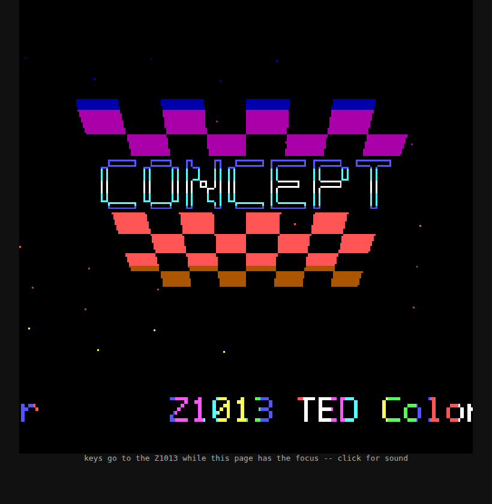

# Z1013 auf dem Arty A7 / Z1013 on the Arty A7

[Deutsch](#deutsch) · [English](#english)



## Aufbau / Structure

The machine is this project's own Z1013 -- `src/testpattern.vhd` with the T80, the RAMs, the boot ROM, the keyboard,
the SD reader and the raster, and `src/hdmi_audio/ted_sound_core.sv` -- **unchanged**.  `src/arty/` only wraps it:
instead of HDMI, the SD socket and the USB keyboard companion, the screen, the sound, the card and the keys travel
between the FPGA and a PC over the board's Ethernet (or its USB serial port).  Nothing has to be plugged into the
Arty's Pmod sockets.

```
┌───────────────────────────────────────────── Arty A7-100T (FPGA) ────────────────────────────────────────────────┐
│                                                                                                                  │
│   ╔══ ORIGINAL CORE: ../*.vhd, ../t80/, ../hdmi_audio/ted_sound_core.sv -- unchanged ════════════════════════╗   │
│   ║                                                                                                          ║   │
│   ║   testpattern ── T80 (Z80) · main_ram · boot ROM* · video_ram · color_ram · font_rom                     ║   │
│   ║        │         dual_keyboard / usb_keyboard · sd_spi_block_reader · sector_buffer                      ║   │
│   ║        │ TED registers                                                                                   ║   │
│   ║        └──────▶ ted_sound_core                                                                           ║   │
│   ║                                                                                                          ║   │
│   ╚═══ I_usb_event ▲══════ SD SPI pins ┼═════ raster RGB/DE/VS ▼═══════════ sample ▼═════════════════════════╝   │
│                    │                   │                       │                   │                             │
│   ┌────────────────┼───────────────────┼───────────────────────┼───────────────────┼─────────────────────────┐   │
│   │                │                   │                       │                   │  WRAPPER: src/arty/rtl  │   │
│   │                │                   │                       │                   │  (generated Verilog)    │   │
│   │                │                   │                       │                   │                         │   │
│   │             host_in           sd_card_blk               capture               pcm                        │   │
│   │           keys, card,         an SD card              256x256 of          box filter,                    │   │
│   │          refresh, boot        (SPI mode),            the 512x512,          22 050 Hz                     │   │
│   │                                blk_pipe              changed rows          s16 mono                      │   │
│   │                │                   │                       │                   │                         │   │
│   │        stream_rx pipe 3    stream_tx pipe 2        stream_tx pipe 0    stream_tx pipe 1                  │   │
│   │                └───────────────────┴───────────┬───────────┴───────────────────┘  the debug link:        │   │
│   │                                                │                                  UDP 192.168.77.2,      │   │
│   │                                                │                                  USB-UART 1 Mbaud       │   │
│   │   PLL: 100 → 74.286 MHz                        │                                                         │   │
│   └────────────────────────────────────────────────┬─────────────────────────────────────────────────────────┘   │
└────────────────────────────────────────────────────┼─────────────────────────────────────────────────────────────┘
                                                     │ Ethernet (or the USB cable)
┌────────────────────────────────────────────────────┴─────── PC: src/arty/host/z1013_console.py ──────────────────┐
│   the screen + the sound ──▶ the browser (http://127.0.0.1:8013; click once for the sound)                       │
│   the browser's keys ──▶ the companion's event bytes (F1 @DD, F2 @DL, F3 DOS, F9..F12, Ctrl-Alt-Del)             │
│   the card ◀──▶ build/card.img (FAT32, read only; the machine's writes go to build/card.cow)                     │
└──────────────────────────────────────────────────────────────────────────────────────────────────────────────────┘
   * the boot ROM: rtl/Gowin_Z1013_ROM.vhd -- a portable entity of the same name and ports as
     ../gowin_rom/gowin_z1013_rom.vhd (whose Gowin pROM cells exist on Gowin parts only), its contents generated from
     ../gowin_rom/z1013_boot_rom.bin by rtl/mkrom.py, byte for byte the same
```

| folder | what |
|---|---|
| `rtl/z1013_arty.v`, `rtl/top.v` | the wrapper (generated Verilog: capture, pcm, the card, the keys, the link, the PLL) and the board's top |
| `rtl/Gowin_Z1013_ROM.vhd`, `rtl/mkrom.py` | the portable boot ROM entity and its generator |
| `constr/top.xdc` | pins and clocks |
| `vivado/build.tcl` | the Vivado flow; it reads `../*.vhd`, `../t80/*.vhd`, `../hdmi_audio/ted_sound_core.sv` in place |
| `bit/z1013_arty.bit`, `bit/SHA256SUMS` | the built bitstream |
| `host/` | `z1013_console.py` (the PC side), `mkcard.sh` (the card image), `zlink/` (the link's host modules) |

---

## Deutsch

**Benötigt:** ein Digilent Arty A7-100T, ein Netzwerkkabel vom PC zum Arty (oder nur das USB-Kabel), Python 3 mit
`pyserial` (nur für USB), `mtools` und `dosfstools` (für das Kartenabbild), ein Browser.  `openFPGALoader`: das
installierte, sonst baut `make tools` es aus den Quellen (cmake, C/C++-Compiler, libusb-1.0-, zlib-, libudev-Header).
Vivado nur, um den Bitstream selbst zu bauen.

1. Den Netzwerkanschluss des PCs, an dem der Arty hängt, auf **192.168.77.1/24** stellen (der Arty ist 192.168.77.2).
2. `make run-demo` -- lädt `bit/z1013_arty.bit`, baut `build/card.img` aus `../../programs/`, öffnet den Browser
   und tippt F2 + `DEMO.COM`.  Einmal ins Browserfenster klicken: dann kommt der Ton.
3. `make run` -- dasselbe ohne Tippen; die Tasten des Browsers gehen an den Z1013.
4. Über USB statt Ethernet: `make run LINK=uart` (`UART=/dev/ttyUSB1`).
5. Bitstream selbst bauen: `make bitstream` (Vivado, etwa 15 Minuten, nach `build/top.bit`; `make prog` nimmt ihn dann).

Der Z1013 startet erst, wenn der PC verbunden ist (`make console` verbindet sich mit einem laufenden Z1013, ohne ihn
zurückzusetzen).  Die Karte wird nie geschrieben: `@DS` landet in `build/card.cow`.

## English

**Needs:** a Digilent Arty A7-100T, an Ethernet cable from the PC to the Arty (or only the USB cable), Python 3 with
`pyserial` (USB only), `mtools` and `dosfstools` (for the card image), a browser.  `openFPGALoader`: the installed one,
or else `make tools` builds it from source (cmake, a C/C++ compiler, the libusb-1.0, zlib and libudev headers).  Vivado only to
build the bitstream yourself.

1. Give the PC's port the Arty is cabled to the address **192.168.77.1/24** (the Arty is 192.168.77.2).
2. `make run-demo` -- loads `bit/z1013_arty.bit`, builds `build/card.img` from `../../programs/`, opens the browser and
   types F2 + `DEMO.COM`.  Click into the browser page once to get the sound.
3. `make run` -- the same without typing; the browser's keys go to the Z1013.
4. Over USB instead of Ethernet: `make run LINK=uart` (`UART=/dev/ttyUSB1`).
5. Build the bitstream yourself: `make bitstream` (Vivado, about 15 minutes, into `build/top.bit`; `make prog` then takes it).

The Z1013 starts when the PC has connected (`make console` joins a running Z1013 without resetting it).  The card is
never written: `@DS` goes to `build/card.cow`.

### How the link works

The link carries datagrams: UDP ports 0x8E8C .. 0x8E86 (pipes 0..3), or the same datagrams framed on the USB-UART.
Each pipe is a stream bridge in HELD mode -- sequence numbers, the receiver's credits and acknowledgements,
re-sending -- so nothing is lost: the screen sends a row only when it changed (a CRC per row), one row every frame
regardless (the PC's picture heals by itself), the sound 64 samples a frame, the card a sector a request (the original
reader waits ~60 ms for a sector's token; the PC answers in about 2 ms).
